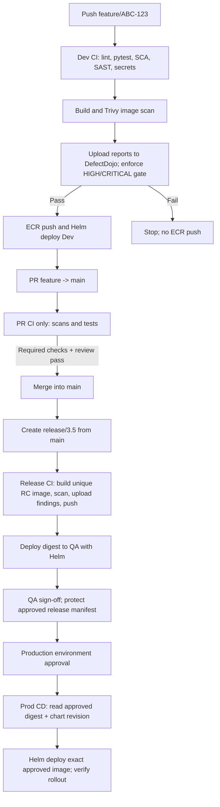
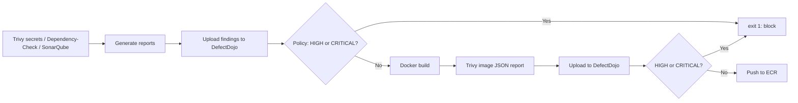

EKS Application CI/CD — GitHub Actions & Jenkins Triggers, Security Gates, Approvals and Promotion
> **Purpose:** An interview-ready explanation of the exact application release strategy: `feature/*` push → Dev; pull request to `main` → CI only; release branch → QA build/deploy; QA-approved image digest → Production with **no rebuild**. Both GitHub Actions and Jenkins are shown. Code examples are **reference patterns**, not drop-in production deployments; substitute account IDs, role ARNs, repository names and chart paths.
1. Executive architecture

Clarification: Feature image and release image may be different. The same QA-approved image digest must go to Production. A release branch is created after merging to main; a PR alone does not create it. Production may use a protected manual trigger, not a fresh build. Git branch names and image tags are labels; a SHA-256 digest identifies content.
2. Trigger matrix
Event	GitHub Actions	Jenkins Multibranch	Outcome	Approval?
Push `feature/ABC-123`	`on.push.branches: ['feature/**']`	`when { branch 'feature/*' }`	Scan, build, Dev deploy	Usually automatic to nonprod sandbox
Open/update PR targeting `main`	`on.pull_request.branches: [main]`	`when { changeRequest target: 'main' }`	Run CI, never deploy	Required status checks + PR reviewer
Merge to `main`	`push` on `main` if configured	Branch `main` job	Optional validation; no image publish needed	Protected branch merge rules
Push `release/3.5`	`push: ['release/**']`	`when { branch 'release/*' }`	Build RC once, scan/publish, deploy QA	Optional QA deployment gate
Promote QA release	`workflow_dispatch` + `environment: production`	Separate deployment job + `input`	Deploy existing digest, never rebuild	Mandatory production approval
Use required GitHub branch checks to stop an unsafe merge. PR approval and deployment approval are distinct decisions. Configure production job to accept only approved releases, not an arbitrary digest passed by a user.
3. Core security stage: report first, fail second

Run independent checks even when one detects vulnerabilities, archive reports, then calculate an explicit final decision. Distinguish finding present from scanner execution failed; missing/malformed reports, failed scans, or failed mandatory DefectDojo uploads should fail closed. For secrets, blocking any verified exposed credential is safer than assigning it a generic severity. SonarQube uses a Quality Gate, not necessarily the same HIGH/CRITICAL severity vocabulary. Approved, time-bounded exceptions must be audited.
```bash
# Example image phase after Docker build: does NOT fail until the report is saved.
mkdir -p reports
trivy image --scanners vuln --format json --exit-code 0 \
  --output reports/trivy-image.json "$IMAGE_URI"

# Upload BEFORE gate (requires DEFECTDOJO_URL/TOKEN/ENGAGEMENT_ID)
curl --fail-with-body --retry 3 -sS \
  -H "Authorization: Token $DEFECTDOJO_TOKEN" \
  -F "scan_type=Trivy Scan" \
  -F "engagement=$DEFECTDOJO_ENGAGEMENT_ID" \
  -F "file=@reports/trivy-image.json" \
  "$DEFECTDOJO_URL/api/v2/import-scan/"

# Policy gate. jq -e also ensures a malformed/missing report cannot pass.
jq -e '.Results | type == "array"' reports/trivy-image.json >/dev/null || exit 1
count=$(jq '[.Results[]?.Vulnerabilities[]? | select(.Severity == "HIGH" or .Severity == "CRITICAL")] | length' reports/trivy-image.json) || exit 1
[ "$count" -eq 0 ] || { echo "Blocked: $count HIGH/CRITICAL vulnerabilities"; exit 1; }
```
Exit code: `exit 0` succeeds; `exit 1` fails a shell step by default. Don't suppress the final gate with GitHub `continue-on-error` or Jenkins `catchError`. Use `if: always()` / `post { always { ... } }` for publishing reports, not for ECR promotion.
4. GitHub Actions: event-triggered CI routing
Save as `.github/workflows/app-ci.yml` (illustrative). `ci/security-source.sh` is a repo-owned wrapper you must implement to run lint, pytest, coverage, Trivy secrets, OWASP Dependency-Check and SonarQube, upload reports, and enforce source gates; `ci/publish-deploy.sh` performs the image build, Trivy image report/upload/gate, ECR push, digest retrieval and Helm deployment. These scripts are deliberately referenced instead of pretending a few commands are a complete enterprise pipeline.
```yaml
name: app-ci
on:
  push:
    branches: ['feature/**', 'release/**']
  pull_request:
    branches: [main]
permissions:
  contents: read
jobs:
  validate:
    runs-on: ubuntu-latest
    steps:
      - uses: actions/checkout@v4
      - name: Unit tests + source security + DefectDojo + gate
        run: ./ci/security-source.sh

  deploy-dev:
    needs: validate
    if: github.event_name == 'push' && startsWith(github.ref, 'refs/heads/feature/')
    runs-on: [self-hosted, linux, dev-deployer]
    environment: dev
    permissions:
      contents: read
      id-token: write
    steps:
      - uses: actions/checkout@v4
      - uses: aws-actions/configure-aws-credentials@v4
        with:
          role-to-assume: ${{ vars.DEV_CI_DEPLOY_ROLE_ARN }}
          aws-region: ap-south-1
      - run: ./ci/publish-deploy.sh dev "$GITHUB_SHA"

  deploy-qa:
    needs: validate
    if: github.event_name == 'push' && startsWith(github.ref, 'refs/heads/release/')
    runs-on: [self-hosted, linux, qa-deployer]
    environment: qa
    permissions:
      contents: read
      id-token: write
    steps:
      - uses: actions/checkout@v4
      - uses: aws-actions/configure-aws-credentials@v4
        with:
          role-to-assume: ${{ vars.QA_CI_DEPLOY_ROLE_ARN }}
          aws-region: ap-south-1
      - run: ./ci/publish-deploy.sh qa "$GITHUB_SHA"
```
Read the GitHub syntax like a beginner
Line	Meaning
`on: push`	Start after commits are pushed to matching branches.
`on: pull_request`	Start PR checks when target branch is `main`, including PR updates.
`jobs.validate`	Independent machine/job executing the initial checks.
`needs: validate`	Do not deploy unless `validate` succeeded.
`if: github.event_name == 'push'`	PR checks cannot deploy.
`startsWith(github.ref, 'refs/heads/release/')`	Only release branch pushes can run QA job.
`runs-on`	Selects a runner; self-hosted labels must exist.
`environment: qa`	Apply QA deployment rules and variables; does not itself mandate approval.
`id-token: write`	Let GitHub request an OIDC token for AWS STS; does not grant AWS privileges by itself.
`configure-aws-credentials`	Exchange GitHub OIDC token for temporary IAM role credentials.
`vars.QA_CI_DEPLOY_ROLE_ARN`	Role ARN configured in GitHub environment/repository variables.
`GITHUB_SHA`	Git commit associated with this execution; use it to label traceable images.
Note: For production, pin reviewed actions to immutable full commit SHAs, protect workflow modifications, and prefer separate CI publisher and CD deploy roles. Use release tags such as `3.5.0-rc.1-<short-sha>` and deploy by digest; publish a protected release manifest listing image digest, Git commit, chart revision, scan status and QA approval.
5. GitHub Actions: production approval + no rebuild
Save separately as `.github/workflows/app-prod.yml` (reference skeleton).
```yaml
name: promote-approved-release
on:
  workflow_dispatch:
    inputs:
      release:
        description: Approved release number (e.g. 3.5)
        type: string
        required: true
permissions:
  contents: read
  id-token: write
jobs:
  deploy-prod:
    # Production approval happens BEFORE this job starts.
    environment: production
    runs-on: [self-hosted, linux, prod-deployer]
    concurrency: production-storefront
    steps:
      - uses: actions/checkout@v4
      - uses: aws-actions/configure-aws-credentials@v4
        with:
          role-to-assume: ${{ vars.PROD_DEPLOY_ROLE_ARN }}
          aws-region: ap-south-1
      - name: Verify approved immutable release
        env:
          RELEASE: ${{ inputs.release }}
        run: |
          # ci/get-approved-release.sh must validate release identifier,
          # QA signoff, source SHA, chart revision, digest and approvals.
          ./ci/get-approved-release.sh "$RELEASE" > release.env
      - name: Deploy existing QA-approved digest
        run: |
          # ci/deploy-approved.sh reads validated release.env and runs
          # helm upgrade --install ... --set-string image.digest=...
          ./ci/deploy-approved.sh production release.env
```
Exactly how to enable GitHub approval
Go to Repository → Settings → Environments → New environment, name it `production`.
Enable Required reviewers, select authorized team members, and preferably Prevent self-review.
Restrict deployment branches/tags; use separate Dev and QA environments as needed.
The line `environment: production` associates the job with these protections; approval is configured in GitHub Settings, not in YAML. The job is held before its steps and protected environment secrets become available. Availability depends on GitHub plan and repository visibility.
A manually dispatched workflow is not equivalent to reviewer approval. Use both protected environments and a controlled release manifest.
AWS and Kubernetes access
Create GitHub OIDC identity provider in AWS IAM (`https://token.actions.githubusercontent.com`, audience `sts.amazonaws.com`), not IAM Identity Center.
Role trust must allow `sts:AssumeRoleWithWebIdentity` and restrict `aud` and `sub` to approved repository branches/environments. An environment-qualified subject typically looks like `repo:ORG/REPO:environment:production`.
The CI role needs relevant ECR push permissions. The deployment role needs `eks:DescribeCluster` and an EKS access entry + scope-limited EKS policy/Kubernetes RBAC. `aws eks update-kubeconfig` only configures connectivity; it does not grant Kubernetes permissions.
Production runner must have network access to EKS endpoint and ECR; keep it isolated from untrusted PR builds.
```bash
aws sts get-caller-identity
aws eks update-kubeconfig --region ap-south-1 --name "$EKS_CLUSTER"
kubectl auth can-i patch deployments -n production
helm upgrade --install storefront ./helm -n production \
  -f helm/values-prod.yaml \
  --set-string image.repository="$ECR_URI" \
  --set-string image.digest="$APPROVED_DIGEST" \
  --wait --atomic
kubectl rollout status deployment/storefront -n production --timeout=300s
```
The Helm chart must render `image: "{{ .Values.image.repository }}@{{ .Values.image.digest }}"`; namespaces, values files and EKS access must be provisioned. If images cross AWS accounts/registries, verify the destination digest after promotion without rebuilding.
6. Jenkins: Multibranch triggers and deploy stages
Set up a Jenkins Multibranch Pipeline with GitHub Branch Source, credentials for GitHub, branch/PR discovery, and GitHub webhook. Jenkins detects branch/PR events; `when` controls individual stages. Avoid builds on the Jenkins controller; use dedicated ephemeral agents with narrowly scoped AWS identities.
```groovy
pipeline {
  agent { label 'docker-aws-tools' }
  options { timestamps(); disableConcurrentBuilds() }
  stages {
    stage('Checkout') {
      steps { checkout scm }
    }
    stage('CI Checks + DefectDojo Security Gate') {
      steps { sh './ci/security-source.sh' }
    }
    stage('Dev build, scan, push, deploy') {
      when {
        allOf {
          not { changeRequest() }
          branch 'feature/*'
        }
      }
      steps { sh './ci/publish-deploy.sh dev "$GIT_COMMIT"' }
    }
    stage('QA build, scan, push, deploy') {
      when {
        allOf {
          not { changeRequest() }
          branch 'release/*'
        }
      }
      steps { sh './ci/publish-deploy.sh qa "$GIT_COMMIT"' }
    }
  }
  post {
    always { archiveArtifacts artifacts: 'reports/**/*', allowEmptyArchive: true }
    failure { echo 'Security gate or stage failed; no downstream promotion.' }
  }
}
```
Jenkins expression	Beginner meaning
`agent { label 'docker-aws-tools' }`	Find a compatible agent to execute the build.
`checkout scm`	Checkout the SCM revision Jenkins selected.
`changeRequest()`	True for discovered PR/change-request build.
`changeRequest target: 'main'`	True when PR destination is `main`; use it for PR-only checks.
`not { changeRequest() }`	Prevent PR pipelines from executing privileged deployments.
`branch 'feature/*'`	Restrict stage to feature branch builds.
`branch 'release/*'`	Restrict stage to release branch builds.
`sh`	Run shell command; nonzero exit ordinarily fails stage.
`post { always { ... } }`	Preserve reports even if validation fails.
Jenkins separate Production deployment job
Use a separate restricted Jenkins job with a release parameter, dedicated agent, and authorized `input`. The script loads the approved release manifest and does not build or push an image.
```groovy
pipeline {
  agent { label 'prod-deploy-agent' }
  parameters {
    string(name: 'RELEASE', defaultValue: '3.5', description: 'Approved release')
  }
  options { timestamps(); disableConcurrentBuilds() }
  stages {
    stage('Production Approval') {
      steps {
        timeout(time: 1, unit: 'HOURS') {
          input message: "Deploy approved release ${params.RELEASE} to Production?",
                ok: 'Approve', submitter: 'production-deployers'
        }
      }
    }
    stage('Deploy QA-approved artifact') {
      steps {
        sh './ci/deploy-approved-release.sh "$RELEASE" production'
      }
    }
  }
}
```
Jenkins approval line: `input message: ..., submitter: ...`. The submitter value relies on Jenkins authorization configuration. Protect the job definition and its scripts, validate release input, and ensure the agent is authenticated to AWS through an EC2 instance profile, EKS Pod Identity or a separate `sts:AssumeRole` boundary.
7. Release failure / hotfix cases
PR scan fails: merge blocked by required checks; no environment deployment.
Source scan detects HIGH/CRITICAL: upload findings first; fail CI with `exit 1`; do not build/push.
Image scan detects HIGH/CRITICAL: upload image findings first; fail; do not push ECR.
QA bug: fix on `release/3.5`; build new unique candidate (`rc.2`); retest and reapprove. Back-merge fixes to main.
Prod rollback: redeploy the previous approved image digest and chart revision, inspect Helm history/health and follow incident procedure.
Production scanner/DefectDojo outage: do not silently bypass required gates. Record failure and stop publication.
Changed release branch after QA: invalidate approval; require new QA testing or pin a signed immutable release tag and digest.
8. Senior DevOps interview questions
Why doesn't a PR deploy? `pull_request` triggers validation; deployment jobs are filtered to `push` and protected environments.
Which line forces approval in GitHub? `environment: production` references settings where required reviewers are configured; YAML alone doesn't enforce reviewers.
Which line forces approval in Jenkins? The `input` step pauses for authorized approval.
Why not rebuild in Production? Same QA-tested digest eliminates build drift and supports provenance.
Can Dev and QA use different runtime config? Yes: same app binary may use separate Helm values, Secrets and environment URLs.
Why use EKS access entries? IAM assumes identity; EKS access entry/RBAC authorizes Kubernetes operations.
Why separate runners and AWS roles? Limit blast radius and protect production from untrusted feature/PR code.
What blocks high/critical findings? Explicit policy evaluation returning nonzero after findings are uploaded; missing reports must fail too.
9. Validation checklist
[ ] GitHub branch protection requires CI on PR to main.
[ ] Feature build routes only to Dev; release build routes only to QA.
[ ] Production workflow/job uses approved digest and immutable chart revision; no rebuild.
[ ] Security findings uploaded to DefectDojo before pipeline gate.
[ ] Required reviewers configured in GitHub production environment / Jenkins input approvers.
[ ] AWS IAM trust conditions and EKS access entries are scoped per environment.
[ ] Runner tools, private connectivity, test URLs and Helm values are configured.
[ ] Rollback and QA-fix procedure tested.
Official reference links
GitHub Actions Environments
GitHub Managing Environments
Jenkins Declarative Pipeline Syntax
Jenkins Multibranch Pipelines
Jenkins Input Step
