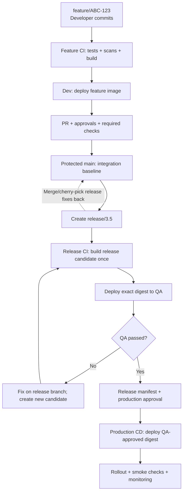
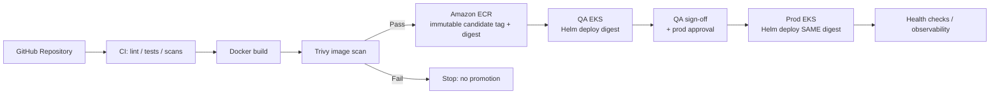
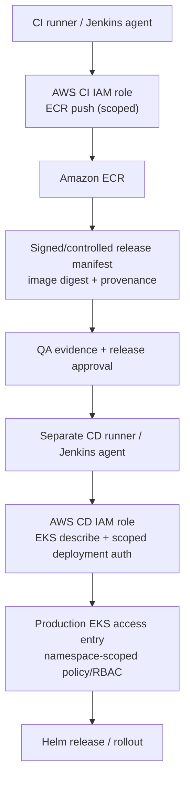

Enterprise Release Strategy: Build Once, Promote the Same Container Image
> **Reference architecture:** GitHub Actions or Jenkins · Python application · Docker · Amazon ECR · Helm · Amazon EKS · Dev / QA / Production  
> **Purpose:** Explain branch-based development, release candidates, immutable artifacts, approvals, safe promotion, rollback, and AWS authentication for a production-grade CI/CD system.  
> **Scope:** Deployment and release-management strategy. Examples are templates—replace account numbers, chart paths, permissions, and environment names with your actual configuration.
Table of Contents
Executive summary
Git branching and release lifecycle
Architecture diagrams
What does “same image” mean?
Pipeline stages and gates
Image tagging, ECR immutability, and digests
Release manifest and artifact promotion
Helm configuration and deployments
Production approvals and AWS authentication
Failure, bug fix, hotfix, and rollback scenarios
Operational security and controls
End-to-end example: release 3.5
Interview questions and sample answers
Trade-offs and alternative release models
Production readiness checklist
References
---
1. Executive summary
We use feature branches for developer validation in Dev. After review, changes merge into protected `main`. A release branch (for example `release/3.5`) is created from an approved `main` commit. The release CI pipeline builds and scans a release candidate once, pushes it to Amazon ECR, and records its immutable image digest. QA tests the candidate. After QA sign-off and a separate production approval, Production deploys the same digest—there is no Docker build in production CD.
Important distinction: Feature branch builds for Dev usually produce different images from the release candidate. The build-once guarantee applies to the QA → Production promotion chain. To use literally one artifact in Dev, QA, and Prod, start with a single release-candidate build and promote its digest through all three stages.
Rules we enforce
Source promotion: Reviewed code merges to `main`, then release branch is cut from a known, approved commit.
Artifact immutability: A unique image tag labels each build; deploy using the digest (`repo@sha256:...`).
Environment separation: QA and Production have different Helm values and AWS roles, but use the same application image digest.
Security before promotion: Quality, unit testing, secret scanning, SCA/SAST, image scanning, and mandatory policies must pass.
Approval: QA sign-off and production release approval are explicit, auditable gates.
No rebuild in Prod: Production CD only resolves a previously approved release artifact and deploys it.
Traceability: Store Git SHA, build ID, image digest, chart version, security reports, QA status, approvals, and deployment history.
---
2. Git branching and release lifecycle
Branch or ref	Purpose	Build?	Deployment
`feature/ABC-123-add-cart`	Developer changes and isolated feature testing	Yes, as needed	Dev or ephemeral preview namespace
Pull request to `main`	Review, tests, mandatory checks	Tests; image build optional	No production deployment
`main`	Integration baseline; protected and up to date	Run at least validation CI	No deployment required
`release/3.5`	Freeze/select changes for version 3.5	One image per release-candidate commit	QA
Protected Git tag `v3.5.0`	Marks the approved release commit	No new build required	Used for audit/release metadata
Approved release manifest	Identifies the tested digest and chart	Never rebuild	Production
Why run CI on `main` if no deployment occurs? Required pull-request checks protect merges, but post-merge validation catches integration issues and records a tested baseline. `main` can be deployment-free while still being tested.
Branch progression

Example naming
```text
Git feature branch:       feature/ABC-123-add-cart
Dev image tag:            feature-abc-123-a1b2c3d
Git release branch:       release/3.5
QA candidate image tag:   3.5.0-rc.1-d4e5f6a
Final Git release tag:    v3.5.0
Artifact deployed in QA:  <ECR_REPOSITORY>@sha256:<APPROVED_DIGEST>
Artifact deployed in Prod:<ECR_REPOSITORY>@sha256:<APPROVED_DIGEST>
```
The release tag `3.5.0` is a version label, not the digest. The digest is the deployable identity.
---
3. Architecture diagrams
3.1 End-to-end release and promotion

3.2 Separation of build and deployment privileges

Network note: CD runner must reach the EKS Kubernetes API endpoint (private cluster endpoints need VPC connectivity). EKS nodes need permission and connectivity to pull the image from ECR. AWS IAM permissions and Kubernetes authorization are separate.
---
4. What does “same image” mean?
Two possible strategies
A. Your intended branch-based flow (recommended when Dev is for feature testing)
`feature/*` builds a feature image and deploys it to Dev.
`release/3.5` builds a new release-candidate image and deploys it to QA.
Production reuses exactly that QA-tested image digest.
Therefore QA = Prod artifact, while Dev may have used another image.
B. Strict build once across all three environments
Cut release candidate from approved source.
Build one candidate image.
Deploy the same digest to Dev → QA → Prod.
Each environment applies different Helm values and secrets; no image rebuilds.
Both models are valid. Do not claim strict Dev→QA→Prod artifact identity if Dev uses a feature-branch build and QA builds again later.
Docker image vs deployment configuration
Image contents remain identical. Configuration may differ:
Configuration	Dev	QA	Production
Replicas	1	2	3+
External API endpoints	Dev services	QA services	Production services
Resource requests	Small	Representative	Sized from SLOs
Secrets	Dev secret references	QA secret references	Production secret references
Docker image digest	Feature or release candidate	Release digest D	Same release digest D
Avoid baking environment configuration or credentials into the Docker image; inject through Kubernetes config and a secret-management integration.
---
5. Pipeline stages and gates
Feature CI (`feature/*`) → Dev
Git checkout and branch/commit metadata.
Format, lint, and static checks (`ruff` / `pylint` for Python).
Unit tests (`pytest`), JUnit output, coverage XML.
Trivy filesystem secret scanning.
OWASP Dependency-Check or another approved SCA tool.
SonarQube SAST analysis with imported test/coverage results and blocking quality gate. SonarQube reads reports; pytest runs the tests.
Build feature image; tag with sanitized branch and commit SHA.
Trivy Docker image vulnerability scan; fail on policy-defined severity/exit code.
Publish approved feature image to ECR.
Deploy to isolated Dev namespace; run smoke tests.
Pull request and `main` validation
Required checks pass before merge (no untrusted code on privileged runners).
Code review/branch protection checks enforced.
Post-merge CI on `main` verifies integration. No deployment from `main` is required.
Release CI (`release/3.5`) → QA
Verify release branch was cut from the intended `main` commit.
Re-run validation, tests, coverage, secret/SCA/SAST policy gates.
Build unique release candidate image (for example `3.5.0-rc.1-d4e5f6a`).
Run Trivy image scan and collect results, SBOM/provenance (where configured).
Push to ECR; capture immutable repository + SHA-256 digest.
Generate a release manifest and attach test/scan/build evidence.
Deploy candidate digest to QA via Helm (or GitOps controller).
Execute integration/end-to-end/regression tests, verify telemetry, and record QA sign-off.
Production CD (promotion only)
Trigger against a specific approved release manifest, not merely a movable branch name.
Check release approvals and verify the image digest, chart, and provenance match QA evidence.
Assume the production CD IAM role; authenticate to EKS.
Deploy the QA-approved digest using production Helm values.
Validate deployment rollout, smoke tests, error rate and latency metrics.
Record deployed manifest/digest and release status; halt or revert safely on failure.
Gate	Stops build?	Stops QA?	Stops Prod?
Lint / unit tests / coverage	Yes	Yes	Not rerun by default; verify approved build evidence
SonarQube quality gate	Yes	Yes	Verify approved build evidence
Secret / SCA / Trivy image policies	Yes	Yes	Verify approved scan evidence, expiry, exceptions
QA tests failed	N/A	Yes	Yes
Required production approval missing	N/A	N/A	Yes
Helm rollout / smoke test failed	N/A	Fail QA release	Fail promotion / invoke runbook
Store scanning reports even when a gate fails. Risk-acceptance exceptions should be approved, time-bounded, and auditable—not implemented by globally disabling the scans.
---
6. Image tagging, ECR immutability, and digests
Recommended tags include commit SHA to avoid collisions:
```text
feature-abc-123-a1b2c3d
3.5.0-rc.1-d4e5f6a
3.5.0-rc.2-b7c8d9e
```
Do not overwrite `3.5` or `latest` as the deployment identifier. Configure ECR tag immutability for release repositories and use image digests in QA/Prod. A unique tag is only immutable when the registry disallows replacing it; a digest points to an exact image manifest.
Example build / scan / push (AWS permissions and security gates must already be satisfied):
```bash
set -euo pipefail
AWS_REGION=ap-south-1
AWS_ACCOUNT_ID=123456789012
REPO=storefront
TAG=3.5.0-rc.1-d4e5f6a
REGISTRY="${AWS_ACCOUNT_ID}.dkr.ecr.${AWS_REGION}.amazonaws.com"
IMAGE="${REGISTRY}/${REPO}:${TAG}"

docker build --pull -t "$IMAGE" .
trivy image --exit-code 1 --severity HIGH,CRITICAL "$IMAGE"

aws ecr get-login-password --region "$AWS_REGION" \
  | docker login --username AWS --password-stdin "$REGISTRY"
docker push "$IMAGE"

# Resolve the ECR manifest digest *after push*.
DIGEST="$(aws ecr describe-images \
  --region "$AWS_REGION" --repository-name "$REPO" \
  --image-ids imageTag="$TAG" \
  --query 'imageDetails[0].imageDigest' --output text)"

test "$DIGEST" != 'None'
printf 'Approved candidate: %s/%s@%s\n' "$REGISTRY" "$REPO" "$DIGEST"
```
For multi-architecture images, ensure the digest corresponds to the manifest/index you intend to promote and that target nodes support the selected platforms. Trivy policies should scan the relevant architectures/manifests.
Do we retag to `3.5.0` after QA?
Optionally, add a human-friendly release tag pointing to the same image manifest, if registry policy permits. This is a metadata operation, not a rebuild. Production should still deploy the approved digest, not resolve a floating tag at deploy time.
---
7. Release manifest and artifact promotion
The pipeline should produce an immutable versioned record, for example `releases/3.5.0-rc.1.json` (stored as a protected build artifact, an artifact repository record, or a signed GitOps commit). Do not let a developer arbitrarily submit an unapproved digest to a privileged production job.
```json
{
  "release": "3.5.0-rc.1",
  "source_branch": "release/3.5",
  "git_sha": "d4e5f6a01234567890abcdef01234567890abcdef",
  "build_id": "release-ci-284",
  "image_repository": "123456789012.dkr.ecr.ap-south-1.amazonaws.com/storefront",
  "image_tag": "3.5.0-rc.1-d4e5f6a",
  "image_digest": "sha256:<64-hex-character-digest>",
  "helm_chart_version": "1.8.0",
  "security_evidence": "release-ci-284/security-reports",
  "qa_status": "approved",
  "qa_approval_reference": "CHANGE-12345"
}
```
The example's digest is a placeholder, not an actual deployable digest. The CD pipeline must verify the approval record from its trusted source, including commit, image digest, chart version, and environment policy; it must not trust an editable JSON field alone.
ECR across multiple AWS accounts
If QA and Production use different ECR registries, promote/copy the already-built OCI image rather than rebuilding it. Verify the artifact integrity and destination digest; registry transformations and manifest formats can affect digest values, so do not blindly assume the destination digest string is always identical. Record source and destination references and verify content/provenance. Restrict ECR pull/push with cross-account repository policies or a controlled promotion role.
---
8. Helm configuration and deployments
Example Helm chart structure (illustrative):
```text
helm/storefront/
├── Chart.yaml
├── values.yaml
├── values-qa.yaml
├── values-prod.yaml
└── templates/
    ├── deployment.yaml
    ├── service.yaml
    └── ingress.yaml
```
8.1 Values and Deployment template
`values.yaml`:
```yaml
image:
  repository: 123456789012.dkr.ecr.ap-south-1.amazonaws.com/storefront
  digest: ""  # supplied by trusted CD release manifest
  pullPolicy: IfNotPresent
```
`templates/deployment.yaml` (relevant portion):
```yaml
spec:
  template:
    spec:
      containers:
        - name: storefront
          image: "{{ required \"image.repository must be supplied\" .Values.image.repository }}@{{ required \"image.digest must be supplied\" .Values.image.digest }}"
          imagePullPolicy: {{ .Values.image.pullPolicy }}
```
The deployment template requires both a repository and a validated `sha256:...` digest. Ensure these fields come from a trusted, approved release record.
8.2 QA deployment using approved image digest
```bash
set -euo pipefail
helm lint ./helm/storefront -f ./helm/storefront/values-qa.yaml
helm template storefront ./helm/storefront \
  -n qa -f ./helm/storefront/values-qa.yaml \
  --set-string image.digest="$IMAGE_DIGEST" > /tmp/storefront-qa.yaml

helm upgrade --install storefront ./helm/storefront \
  --namespace qa \
  -f ./helm/storefront/values-qa.yaml \
  --set-string image.digest="$IMAGE_DIGEST" \
  --wait --timeout 10m --atomic

kubectl rollout status deployment/storefront -n qa --timeout=5m
```
8.3 Production deployment: same digest, no build
```bash
set -euo pipefail
# IMAGE_DIGEST comes from a verified, QA-approved release manifest.
helm upgrade --install storefront ./helm/storefront \
  --namespace production \
  -f ./helm/storefront/values-prod.yaml \
  --set-string image.digest="$IMAGE_DIGEST" \
  --wait --timeout 10m --atomic

kubectl rollout status deployment/storefront -n production --timeout=5m
kubectl get deployment storefront -n production \
  -o jsonpath='{.spec.template.spec.containers[0].image}{"\n"}'
```
Why `--set-string`? It injects the release digest without editing the chart source. The template renders `repository@sha256:...`. Chart values and a Helm command only control Kubernetes deployment; EKS nodes still need ECR pull permissions.
Why not `--create-namespace` for Prod? Pre-provision and govern namespaces with platform automation. Creation requires additional cluster-scoped privileges, which a namespace-scoped deployment role should not have.
Helm version note: `--atomic` is supported by Helm 3; Helm 4 uses `--rollback-on-failure`. Check `helm upgrade --help` against your installed version.
8.4 Required post-deployment checks
`helm status storefront -n production`
`kubectl get pods -n production -l app=storefront`
`kubectl describe deployment storefront -n production`
Readiness and liveness probes, smoke test against the live route
Prometheus/CloudWatch metrics: availability, latency, error rate, restarts
Confirm deployed image digest equals QA-approved digest
Important: Helm readiness success does not prove business correctness. Use application smoke tests, monitoring, and defined rollback criteria.
---
9. Production approvals and AWS authentication
9.1 GitHub Actions → AWS: OIDC federation
Register the GitHub OIDC identity provider in AWS IAM (not IAM Identity Center):
```text
Provider URL: https://token.actions.githubusercontent.com
Audience:     sts.amazonaws.com
```
Example production-only role trust policy. The following policy illustrates a GitHub Environment subject; adjust organization, repository, and environment after checking the actual token subject shape:
```json
{
  "Version": "2012-10-17",
  "Statement": [{
    "Effect": "Allow",
    "Principal": {
      "Federated": "arn:aws:iam::123456789012:oidc-provider/token.actions.githubusercontent.com"
    },
    "Action": "sts:AssumeRoleWithWebIdentity",
    "Condition": {
      "StringEquals": {
        "token.actions.githubusercontent.com:aud": "sts.amazonaws.com",
        "token.actions.githubusercontent.com:sub": "repo:my-org/storefront:environment:production"
      }
    }
  }]
}
```
Protect the `production` GitHub Environment with required reviewers and allowed branch/tag restrictions. The subject condition restricts who can request credentials; repository protection and environment approval restrict which code can reach that point. Use separate CI/ECR and CD/EKS roles. GitHub OIDC does not itself grant any ECR/EKS permissions—IAM policies on the role must permit the actual operations.
Illustrative GitHub CD workflow excerpt (not a complete working workflow):
```yaml
permissions:
  id-token: write
  contents: read

jobs:
  production:
    environment: production
    runs-on: ubuntu-latest  # or a restricted AWS self-hosted CD runner
    steps:
      - uses: actions/checkout@v4
      - uses: aws-actions/configure-aws-credentials@v4
        with:
          role-to-assume: arn:aws:iam::123456789012:role/github-prod-deploy
          aws-region: ap-south-1
      - run: aws sts get-caller-identity
      # Resolve/verify approved release manifest, then deploy using digest.
```
9.2 Jenkins → AWS: instance profile or STS role assumption
For an EC2-hosted Jenkins agent, attach an EC2 instance profile (temporary credentials via IMDSv2). For least privilege, the agent's base instance role should be limited and allowed to `sts:AssumeRole` into a dedicated deployment role. A Jenkins controller instance role is not automatically available to remote agents; the agent executing `aws`/`kubectl` needs credentials.
Example cross-role assumption on the agent:
```bash
aws sts get-caller-identity
# A controlled Jenkins credentials/role-assumption integration should expose
# temporary credentials for the deployment role to this build step.
aws sts assume-role \
  --role-arn arn:aws:iam::123456789012:role/jenkins-prod-deploy \
  --role-session-name jenkins-release-3-5
```
`assume-role` returns credentials; the command alone does not switch the current shell's identity. A secure Jenkins AWS integration or a carefully scoped credential-provider setup must make those returned temporary credentials available to subsequent AWS commands. Avoid echoing secrets to logs. On EKS-based Jenkins agents, consider EKS Pod Identity/IRSA with careful pod isolation instead of a shared node role.
9.3 EKS authentication vs authorization
Grant the deployment principal IAM permission for `eks:DescribeCluster`. Register the exact CD IAM role ARN as an EKS access entry if using EKS access-entry authentication mode. Associate a namespace-scoped `AmazonEKSEditPolicy` or appropriately designed Kubernetes RBAC with `production`—not unrestricted cluster admin by default.
```bash
aws eks update-kubeconfig --region ap-south-1 --name production-eks
aws sts get-caller-identity
kubectl auth can-i patch deployments -n production
kubectl auth can-i create secrets -n production
```
`aws eks update-kubeconfig` updates client connection/authentication configuration; it does not grant Kubernetes permissions. `kubectl`/Helm invoke AWS token authentication at execution time; EKS access policies and Kubernetes RBAC determine allowed Kubernetes actions. Namespace-scoped edit access can still permit sensitive operations (for example, reading/configuring some secrets and modifying workloads), so evaluate narrower custom RBAC and dedicated service accounts for production.
9.4 Network and access boundaries
GitHub-hosted runners need a network path to the Kubernetes API; prefer a dedicated AWS-hosted CD runner for private endpoints.
AWS-hosted GitHub self-hosted runners can be ephemeral EC2, CodeBuild-hosted, or ARC pods on a separate runner EKS cluster.
Jenkins controller runs privately; builds run on ephemeral agents with restricted egress.
CI role: ECR push, security report uploads; no production EKS writes.
Prod CD role: EKS describe and namespace-scoped deployment rights; no Docker build or ECR push.
EKS worker identity: sufficient ECR pull permissions; CI/CD role credentials are not automatically passed into running pods.
---
10. Failure, bug fix, hotfix, and rollback scenarios
QA finds a defect in `3.5.0-rc.1`
Fix the issue on `release/3.5` with review.
Run release CI again and build `3.5.0-rc.2-<newsha>`.
Scan and push a new digest; never overwrite `rc.1`.
Deploy `rc.2` to QA; repeat required tests and approvals.
Promote only the newly approved digest to Production.
Merge/cherry-pick the fix back to `main` to prevent drift.
A new commit lands on the release branch after QA approval
Old approval applies to the previously tested commit + digest + Helm chart/configuration. A changed build or deployment configuration requires re-evaluation and, as policy dictates, new testing/approval. Do not re-resolve `release/3.5` at deployment time and accidentally deploy untested code.
Production rollout fails
`helm upgrade --install --atomic` (Helm 3) can roll back for Helm readiness failures, provided the chart and readiness behavior support it.
Application-level failures may appear only after Helm succeeds. Monitor deployment and follow an explicit operational rollback runbook.
Inspect `helm history storefront -n production`; `helm rollback storefront <known-good-revision> -n production` if safe.
Check database/schema compatibility: rolling back Kubernetes resources does not undo destructive database migrations.
Record incident details, approved rollback digest, and outcome.
Production hotfix
Branch a hotfix from the current production release commit (or appropriately selected baseline).
Review change; run full relevant CI and security checks.
Build a unique hotfix release-candidate image.
QA/smoke validate via a risk-based emergency path with auditable approval.
Promote the same hotfix digest to Production; reconcile fixes into `main` and active release branches.
Retagging and ECR replication gotchas
Changing a tag in Helm without verifying the registry artifact can accidentally deploy the wrong build.
ECR tag immutability blocks overwriting an existing tag; choose unique names or a controlled alias policy.
Cross-account/cross-region replication may not share the exact digest if a registry changes image manifest format. Verify the promoted artifact and record its destination digest.
Keep previous approved images and Helm revisions for recovery; retention policies should not delete deployed artifacts.
---
11. Operational security and controls
Control	Expected enterprise implementation
Runner isolation	Ephemeral runners/agents; trusted and untrusted workflows separated
Identity	GitHub OIDC or Jenkins workload role; short-lived STS credentials
Least privilege	Different CI publisher and Prod deploy roles; namespace-specific K8s authorization
Supply chain	Dependency scanning, secret scanning, SAST, Trivy image scanning, SBOM, provenance/signature if available
Registry	ECR encryption, tag immutability, lifecycle and pull-policy controls
Policy	Block policy-defined findings; approved exceptions documented
Artifact traceability	Immutable release manifest with Git SHA, digest, chart, scans, QA and approvals
Deployment	Production approval, private EKS connectivity, validated Helm chart, controlled changes
Monitoring	CloudTrail, pipeline audit logs, EKS audit logs, application SLO telemetry
Recovery	Prior digest retained, Helm rollback plan, database migration compatibility
Drift	Reconciliation between GitOps/release record and actual running digest
Security tooling boundary: `pytest` executes unit tests; `pytest-cov` outputs coverage; SonarQube imports coverage/JUnit reports and performs code analysis. Trivy secret scanning and image scanning are separate from SCA (e.g., OWASP Dependency-Check). DAST is not part of this reference pipeline.
---
12. End-to-end example: release 3.5
Step	Actor / system	State / output
1	Developer	Pushes `feature/ABC-123`; receives Dev image `feature-abc-123-a1b2c3d`
2	Feature CI	Runs tests/scans; image deployed in Dev
3	PR reviewers	Approve and merge into protected `main`
4	Release manager	Creates `release/3.5` from known `main` SHA
5	Release CI	Builds `3.5.0-rc.1-d4e5f6a` once, scans, pushes ECR
6	CI artifact service	Records image digest D, commit, chart and scan evidence
7	QA CD	Deploys `storefront@D` using QA Helm values
8	QA testers	Approve D after regression/integration tests
9	Production approver	Approves manifest referencing D and a specific chart
10	Production CD	Deploys `storefront@D` using Prod Helm values; no build
11	SRE / platform	Verifies rollout, app health, dashboards and digest
12	Release manager	Creates protected Git tag `v3.5.0`, updates release record
Proof of artifact equality: Compare the `image:` field from QA and Production Deployments. It should reference the same repository/digest (or verified equivalent promotion record in a cross-registry setup).
```bash
kubectl get deployment storefront -n qa \
  -o jsonpath='{.spec.template.spec.containers[0].image}{"\n"}'
kubectl get deployment storefront -n production \
  -o jsonpath='{.spec.template.spec.containers[0].image}{"\n"}'
```
The desired image reference can be inspected above. Confirm running pods and image IDs as well (`kubectl get pods -o json`) if investigating a rollout or image pull issue.
---
13. Interview questions and sample answers
Q1. Why do you build once and promote the same image?  
Because rebuilding may introduce changed dependencies, base images, toolchains, or build-time behavior. Promoting a verified digest improves traceability and reduces the risk of releasing an artifact different from the one tested.
Q2. Does your approach guarantee the same image in Dev, QA, and Prod?  
Not necessarily: feature images go to Dev, while the release image is built when the release branch is cut. QA and Production use the same release digest. For strict three-environment identity, deploy the same candidate digest to Dev first.
Q3. What is the difference between an image tag and digest?  
A tag is a human-readable pointer that may be changed unless immutability is enforced; a digest identifies an exact OCI image manifest. Deploy the digest for a verifiable artifact identity.
Q4. Why run CI on `main` if it never deploys?  
`main` is an integration baseline. Post-merge checks detect integration issues and supply trustworthy evidence before release branching.
Q5. Where does QA sign-off happen?  
In a controlled approval system tied to a specific release manifest and digest, not merely to a branch name.
Q6. What exactly changes between QA and Production?  
Namespace/cluster/account, Helm environment values, secret references, replica count and runtime endpoints. The tested application image digest does not change.
Q7. How does Production know which image to deploy?  
It reads a protected/verified release manifest containing the QA-approved digest and chart version and checks approval status before running Helm.
Q8. What happens when QA detects a bug?  
Fix on the release branch, build a new unique candidate, re-run scanning/testing, then approve the replacement digest. Never overwrite an already tested tag.
Q9. How do GitHub Actions and Jenkins authenticate to AWS?  
GitHub can federate via OIDC and `AssumeRoleWithWebIdentity`. Jenkins agents on EC2 can obtain short-lived instance profile credentials and assume narrower CI/CD roles. On EKS, agents can use Pod Identity/IRSA. Both require scoped IAM permissions.
Q10. Does `aws eks update-kubeconfig` grant cluster access?  
No. It writes Kubernetes client configuration. EKS authentication plus EKS access entries/Kubernetes authorization govern `kubectl` and Helm operations.
Q11. Why separate CI and Production CD roles?  
A compromised build workflow should not automatically gain write access to production infrastructure. CI publishes immutable artifacts; CD has scoped deployment rights gated by approvals.
Q12. How do you roll back?  
Redeploy the previously approved image digest/chart configuration or use a known-good Helm revision with a validated rollback runbook; confirm database compatibility and production health.
Q13. What if an image vulnerability is discovered after QA approval?  
Re-evaluate release security policy, block promotion if required, generate a new candidate after remediation, and reapprove. A prior scan is evidence at a point in time, not a permanent assertion of safety.
Q14. Can you retag an approved image as `3.5.0`?  
Yes, with controlled manifest operations and ECR policy considerations, without rebuilding; but keep digest-based deployment and retain provenance to the QA-approved artifact.
Q15. Why not invoke Docker build from Prod CD?  
Production deploys a prebuilt, verified release artifact; building there breaks build-once promotion and unnecessarily broadens deployment credentials.
---
14. Trade-offs and alternative release models
Release branch model (this document)
Benefits: Explicit code freeze, controlled QA stabilization, versioned candidates, predictable approval chain.  
Costs: Back-merging fixes and maintaining long-lived branches can cause drift. Use short-lived releases and automate merge-back checks.
Trunk-based development with release tags
Teams merge frequently into `main`, produce immutable build artifacts per commit, and promote a chosen approved digest through environments. This reduces branching overhead but requires strong CI, feature flags, and disciplined release controls.
Direct Helm CD vs GitOps with Argo CD
Direct Helm CD: Jenkins/GitHub Actions runs `helm upgrade --install` after approval, authenticates to EKS, and records the deployed digest.
GitOps: Approved digest is committed to a protected environment configuration repository; Argo CD reconciles the cluster. Git history becomes an audit-friendly deployment record, while Argo CD needs its own scoped cluster permissions.
Neither architecture replaces testing, image immutability, review, or monitoring.
---
15. Production readiness checklist
[ ] Feature branches and release branches have documented naming and retention rules.
[ ] `main` uses PR protection, required checks, and post-merge CI validation.
[ ] Release image has a unique tag containing commit SHA; ECR enforces immutability.
[ ] Trivy secrets, dependency/SAST, tests/coverage, and Trivy image gates are defined and enforced.
[ ] The release manifest records commit, digest, chart version, scans, and approvals.
[ ] QA deploys by digest and records the tested candidate.
[ ] Production reads a trusted QA-approved release record and does not rebuild.
[ ] Production GitHub Environment/Jenkins release approval is protected.
[ ] CI and CD IAM roles are separate with short-lived credentials.
[ ] EKS CD access entry/RBAC and private network connectivity are configured.
[ ] Helm chart supports digest deployment and environment-specific values.
[ ] Production namespace is pre-created with least-privilege controls.
[ ] Rollout, smoke tests, SLO monitoring, and rollback runbooks exist.
[ ] Previous approved image digests remain available for rollback.
[ ] Hotfixes and release branch changes are reconciled back to `main`.
---
16. References
Official documentation to consult for version-specific behavior and enterprise controls:
Amazon ECR — Image tag mutability
Amazon ECR — Describing images
GitHub Actions — OIDC in AWS
GitHub Actions — Deployment environments
Amazon EKS — Access entries
Amazon EKS — IAM access policies
Helm — Upgrade
Kubernetes — Images
Trivy — Container image scanning
SonarQube — Python test coverage
---
Interview takeaway: The distinguishing enterprise practice is not merely “tag 3.5 and deploy it twice.” It is: tie a release-candidate digest to a specific reviewed commit, verified security evidence, specific Helm configuration, QA approval, and separately authorized Production promotion—without rebuilding.
