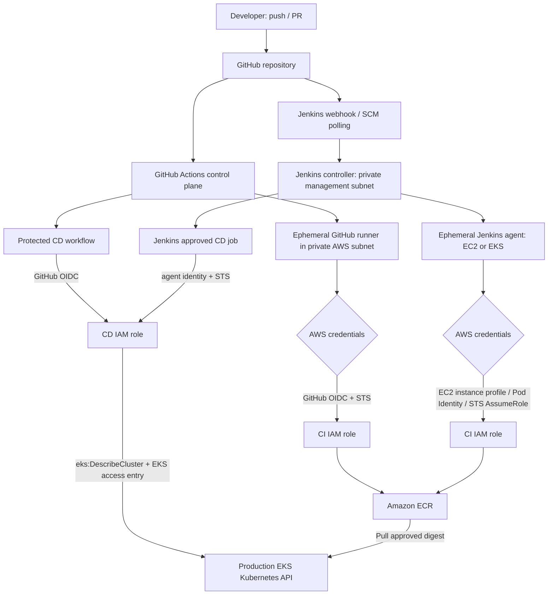
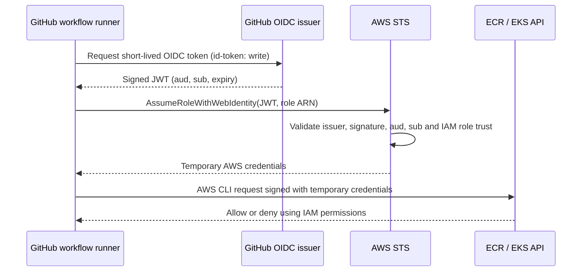
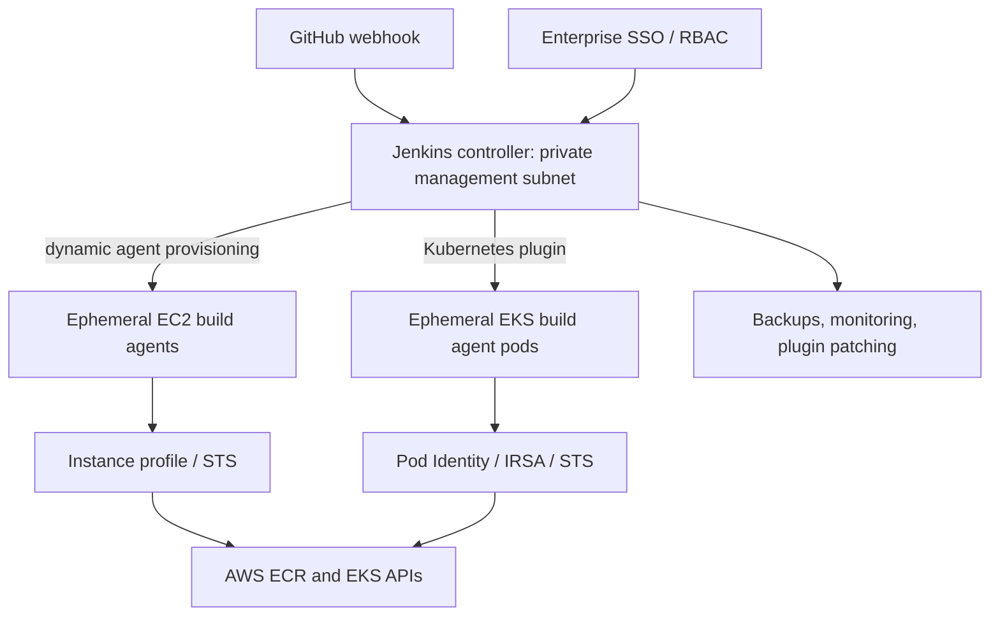

Enterprise CI/CD Runners on AWS: GitHub Actions, Jenkins, IAM, ECR and EKS
> **Purpose:** An architecture and implementation guide for configuring GitHub Actions runners and Jenkins agents in AWS, securing their AWS authentication, pushing images to Amazon ECR, and deploying applications to Amazon EKS. Intended as a senior DevOps/platform-engineering reference and interview preparation guide.
>
> **Scope:** Documentation only. This README does **not** provision AWS infrastructure or change the CI/CD workflows. All account IDs, names and URLs below are examples. Validate policies in a non-production AWS account before adoption.
Contents
Reference architecture and key concepts
How GitHub Actions runners execute jobs
Enterprise ways to host GitHub Actions runners in AWS
GitHub Actions to AWS authentication using OIDC
GitHub Actions: ECR authorization and push
GitHub Actions: EKS authentication and authorization
How enterprises deploy Jenkins on AWS
Jenkins to AWS authentication using EC2 roles and STS
Jenkins agents on EKS: Pod Identity and IRSA
CI/CD role separation, security and networking
Pipeline integration and current repository notes
Validation, troubleshooting and interview questions
Official documentation
---
1. Reference architecture and key concepts
The runner/agent executes pipeline commands. It is separate from the control plane, which schedules jobs and manages their lifecycle. The runner's location (inside or outside AWS) and its AWS identity (OIDC, instance profile, Pod Identity, assumed role) are independent design choices.

Four separate security boundaries:
Boundary	Question	Example
Runner orchestration	Who schedules the job?	GitHub Actions service / Jenkins controller
AWS authentication	What AWS principal is calling APIs?	STS assumed role or EC2 instance role
AWS API authorization	Which AWS actions are allowed?	`ecr:PutImage`, `eks:DescribeCluster`
Kubernetes authorization	Which Kubernetes resources can be changed?	EKS access entry with namespace-scoped edit permissions
Never confuse: GitHub OIDC federation (GitHub → AWS IAM), EKS OIDC/IRSA (Kubernetes service account → AWS IAM), EKS Pod Identity (EKS workload → AWS IAM), and IAM Identity Center (workforce sign-in). They solve different problems.
2. How GitHub Actions runners execute jobs
A GitHub event (`push`, `pull_request`, `workflow_dispatch`) matches a workflow YAML file.
GitHub Actions creates and queues jobs.
The `runs-on` field selects a compatible runner or runner scale set.
The runner communicates outbound to GitHub over TLS, receives the job, checks out code, and executes steps.
Logs and status go back to GitHub; ephemeral runners are removed after jobs.
```yaml
# GitHub-managed runner
jobs:
  tests:
    runs-on: ubuntu-latest
```
```yaml
# Example: enterprise self-hosted runner group and label
jobs:
  tests:
    runs-on:
      group: ci-runners
      labels: [self-hosted, linux, x64]
```
For ARC runner scale sets, `runs-on: arc-ci` can select a scale set configured with that name. A runner label or name is not an authorization boundary by itself: control workflow access to runner groups and the repositories that may use them.
GitHub-hosted versus self-hosted
Option	Who manages the machine?	Typical fit	Key concern
GitHub-hosted	GitHub	Standard tests/builds; simplest operations	Private VPC connectivity needs planning
Persistent EC2 self-hosted	Your team	Lab, legacy build tools	Build-to-build persistence and credential leakage
Ephemeral EC2	Your team / automation	VM-specific builds and strong isolation	Image, registration and lifecycle management
ARC on dedicated EKS cluster	Your platform team	Kubernetes-native dynamic runner pods	Kubernetes/ARC operations and pod isolation
AWS CodeBuild-hosted Actions runner	AWS managed execution	AWS-native ephemeral jobs	Feature fit, cost and AWS integration constraints
For privileged CI and production CD, prefer ephemeral, single-job runners, rather than sharing an always-on host across unrelated repositories or trust levels.
3. Enterprise ways to host GitHub Actions runners in AWS
Option A — Ephemeral EC2 runners
Design: Runner controller/automation launches an EC2 instance into a private subnet for a queued job, registers it as an ephemeral GitHub runner, executes one job and terminates the instance. Keep a hardened AMI with pinned tools (Docker/build tools, AWS CLI, Trivy, Python, Helm, kubectl). Use IMDSv2 and narrowly scoped networking.
Setup checklist:
Create an AWS VPC with private subnets and controlled outbound traffic (NAT/proxy and/or supported VPC endpoints).
Build and patch a hardened AMI; run the agent as an unprivileged user wherever possible.
Configure GitHub organization/repository runner groups with explicit allowlists.
Deploy approved runner autoscaling/lifecycle automation that registers runners through GitHub's API and removes them after one job.
Give the underlying EC2 role only bootstrap/telemetry permissions, not unrestricted ECR or production EKS access.
Authenticate privileged pipeline jobs to AWS through GitHub OIDC with branch/environment-bound role trust policies.
Scrub ephemeral storage and terminate the instance after the job, including on errors.
A manually installed long-lived EC2 runner is useful for learning, but not the preferred enterprise isolation model for untrusted or privileged workloads.
Option B — ARC on a dedicated EKS runner cluster
Design: GitHub Actions Runner Controller (ARC) uses controller/listener components and scale sets to create ephemeral Kubernetes runner pods as jobs arrive. Host ARC in a dedicated build cluster, distinct from production application workloads where practical.
High-level setup:
Provision an EKS cluster, private worker nodes, autoscaling capacity (such as Karpenter or managed node groups), DNS, network egress and observability.
Install the official `gha-runner-scale-set-controller` Helm chart following GitHub's version-specific documentation.
Create a GitHub App with the permissions needed to manage runners; store the App ID, installation ID and private key in a protected Kubernetes Secret or an approved secrets integration. ARC-to-GitHub registration credentials are different from GitHub-to-AWS OIDC credentials.
Install one or more `gha-runner-scale-set` Helm releases (for example, `arc-ci` and `arc-cd`) and configure their runner groups and scale limits.
Configure pod security controls, separate namespaces/node pools, resource limits, egress restrictions, log export, and an ephemeral runner lifecycle.
For container building, evaluate dedicated isolated builders or rootless BuildKit. Do not casually mount the Kubernetes node's Docker socket or grant privileged pods across shared runner workloads.
Restrict production CD scale sets to protected repositories/workflows/environments and give them separate network access and IAM roles.
```yaml
# Sample workflow selector; requires ARC scale set 'arc-ci' to exist
jobs:
  build:
    runs-on: arc-ci
    steps:
      - uses: actions/checkout@v4
      - run: echo 'Runner executed inside the AWS EKS runner cluster'
```
Operational detail: Runner pods may need outbound access to GitHub endpoints, container registries, internal SonarQube, security tools, and AWS services. A private subnet alone does not provide these connections; configure egress routes and DNS deliberately.
Option C — AWS CodeBuild-hosted GitHub Actions runners
AWS CodeBuild can provision managed job execution for GitHub Actions. Consider this when the platform team wants to avoid operating self-hosted runner controllers and worker fleets. Review supported build images, VPC configuration, IAM service roles, webhook settings, concurrency, and how untrusted contributions are handled.
Decision rule: Use GitHub-hosted for straightforward CI; consider CodeBuild for lower-ops AWS execution, ephemeral EC2 for dedicated VM toolchains, and ARC when a platform team already operates Kubernetes and needs pod-based runner scale sets.
4. GitHub Actions to AWS authentication using OIDC
Correct AWS location: Add GitHub's OpenID Connect identity provider under AWS IAM → Identity providers (not IAM Identity Center).
Sequence

Step 1 — IAM OIDC provider
Issuer URL: `https://token.actions.githubusercontent.com`
Audience/client ID: `sts.amazonaws.com`
Step 2 — Role trust policy (CI `main` branch)
```json
{
  "Version": "2012-10-17",
  "Statement": [{
    "Effect": "Allow",
    "Principal": {
      "Federated": "arn:aws:iam::123456789012:oidc-provider/token.actions.githubusercontent.com"
    },
    "Action": "sts:AssumeRoleWithWebIdentity",
    "Condition": {
      "StringEquals": {
        "token.actions.githubusercontent.com:aud": "sts.amazonaws.com",
        "token.actions.githubusercontent.com:sub": "repo:example-org/python-demo:ref:refs/heads/main"
      }
    }
  }]
}
```
`aud` is `sts.amazonaws.com`, not `sts:AssumeRole`. `sub` is the OIDC subject claim, not a repository URL. For a job using a GitHub Environment named `production`, the default subject commonly has the form `repo:example-org/python-demo:environment:production`. Configure a separate CD role with an exact production-environment subject, a protected GitHub Environment, required reviewers and branch restrictions. Do not use a blanket wildcard like `repo:example-org/*` for production deployment trust.
Step 3 — GitHub workflow assumes the CI role
```yaml
permissions:
  contents: read
  id-token: write

steps:
  - uses: aws-actions/configure-aws-credentials@v4
    with:
      role-to-assume: arn:aws:iam::123456789012:role/github-ci-ecr-publisher
      aws-region: ap-south-1
  - run: aws sts get-caller-identity
```
In production, pin third-party Actions to reviewed immutable commit SHAs and keep their versions updated; tags are shown here for readability. Never put static AWS access keys in workflow YAML or GitHub repository secrets when OIDC is available.
Two independent controls must pass: (1) the IAM trust policy determines whether GitHub can assume the role; (2) the IAM permissions policy determines what an assumed role may do.
5. GitHub Actions: ECR authorization and push
Attach a resource-scoped ECR policy to the CI role. The repository must already exist (or be provisioned separately by infrastructure automation).
```json
{
  "Version": "2012-10-17",
  "Statement": [
    {
      "Sid": "ECRAuthToken",
      "Effect": "Allow",
      "Action": "ecr:GetAuthorizationToken",
      "Resource": "*"
    },
    {
      "Sid": "PushOnlyToAppRepository",
      "Effect": "Allow",
      "Action": [
        "ecr:BatchCheckLayerAvailability",
        "ecr:InitiateLayerUpload",
        "ecr:UploadLayerPart",
        "ecr:CompleteLayerUpload",
        "ecr:PutImage",
        "ecr:DescribeImages"
      ],
      "Resource": "arn:aws:ecr:ap-south-1:123456789012:repository/python-demo"
    }
  ]
}
```
```bash
AWS_REGION=ap-south-1
ACCOUNT_ID=123456789012
REPOSITORY=python-demo
IMAGE_TAG=main-4f3a2b1c9d8e
REGISTRY="${ACCOUNT_ID}.dkr.ecr.${AWS_REGION}.amazonaws.com"

aws sts get-caller-identity
aws ecr get-login-password --region "$AWS_REGION" | \
  docker login --username AWS --password-stdin "$REGISTRY"

docker tag "python-demo:${IMAGE_TAG}" "${REGISTRY}/${REPOSITORY}:${IMAGE_TAG}"
docker push "${REGISTRY}/${REPOSITORY}:${IMAGE_TAG}"
aws ecr describe-images --repository-name "$REPOSITORY" \
  --image-ids "imageTag=${IMAGE_TAG}" \
  --query 'imageDetails[0].imageDigest' --output text
```
Security gate: In this project the Docker image is scanned with Trivy before push. If mandatory HIGH/CRITICAL checks fail, the push must not run. Retain the produced reports, even on failed builds. Promote images to CD using their immutable digest, not a mutable branch tag.
6. GitHub Actions: EKS authentication and authorization
EKS access is not automatically granted by AWS OIDC role assumption. The deployment role needs both AWS API permissions and Kubernetes authorization.
Step 1 — IAM permission for EKS cluster discovery
```json
{
  "Version": "2012-10-17",
  "Statement": [{
    "Effect": "Allow",
    "Action": "eks:DescribeCluster",
    "Resource": "arn:aws:eks:ap-south-1:123456789012:cluster/production-eks"
  }]
}
```
Step 2 — EKS access entry for the CD role
The EKS cluster must support access entries and have authentication mode `API` or `API_AND_CONFIG_MAP`. An administrator configures this out-of-band; the normal CD pipeline should not need permission to create or alter its own access entries.
```bash
CLUSTER=production-eks
CD_ROLE_ARN=arn:aws:iam::123456789012:role/github-prod-deployer

# Run these commands as a separately authorized cluster/IAM administrator:
aws eks create-access-entry \
  --cluster-name "$CLUSTER" \
  --principal-arn "$CD_ROLE_ARN" \
  --type STANDARD

aws eks associate-access-policy \
  --cluster-name "$CLUSTER" \
  --principal-arn "$CD_ROLE_ARN" \
  --policy-arn arn:aws:eks::aws:cluster-access-policy/AmazonEKSEditPolicy \
  --access-scope type=namespace,namespaces=python-demo
```
EKS access policies include `AmazonEKSViewPolicy`, `AmazonEKSEditPolicy`, `AmazonEKSAdminPolicy` and `AmazonEKSClusterAdminPolicy`. Admin and ClusterAdmin are not equivalent; scope policies to an application namespace when possible. Custom Kubernetes RBAC is another option for tightly defined permissions.
Step 3 — CD connects and deploys
```bash
aws sts get-caller-identity
aws eks update-kubeconfig --region ap-south-1 --name production-eks
kubectl auth can-i get deployments -n python-demo
kubectl auth can-i patch deployments -n python-demo
helm upgrade --install python-demo ./helm \
  --namespace python-demo \
  --set-string image.digest="sha256:<64_hex_characters>" \
  --wait --atomic --timeout 5m
```
What happens inside `kubectl`: kubeconfig contains an AWS CLI exec credential plugin, which calls `aws eks get-token`. The token proves the AWS IAM role identity; EKS authenticates it and authorizes the Kubernetes request through EKS access policies and/or Kubernetes RBAC.
Critical nuance: `aws eks update-kubeconfig` only constructs the cluster connection configuration. It does not grant EKS permissions. IAM `eks:DescribeCluster`, EKS access-entry authorization, and network reachability to the Kubernetes API are separate requirements.
Namespace creation nuance: An `AmazonEKSEditPolicy` entry scoped to `python-demo` should not be expected to create cluster-scoped `Namespace` resources. A platform administrator should provision the namespace first. Do not rely on `helm --create-namespace` in a least-privilege CD job unless that job is intentionally allowed to create namespaces.
Workload image pulls: EKS worker node roles (or Fargate pod execution roles) separately need permissions to pull from ECR. The pipeline's ECR push role does not grant EKS nodes image-pull access.
7. How enterprises deploy Jenkins on AWS
Typical enterprise architecture:

Controller: Handles pipeline orchestration, credentials integration, web UI/API, audit logs and agent scheduling. Place it in private subnets, use restricted HTTPS access (corporate VPN/identity-aware proxy/ALB as appropriate), persistent encrypted storage, backups, observability, plugin governance and disaster-recovery procedures. Set built-in controller executors to zero; do not run application builds on the controller.
Dynamic EC2 agents: The Jenkins EC2 plugin can spin up approved AMI-based agents according to queue demand and shut them down when idle. Apply per-job labels, IAM instance profiles, isolated workspaces, controlled SSH/inbound agent connectivity and short lifetimes.
Dynamic EKS agents: The Jenkins Kubernetes plugin provisions a pod for a build and removes it afterward. Configure pod templates, Kubernetes service accounts, resource limits, security contexts, namespace separation, and agent-to-controller network connectivity. Prefer a dedicated runner/agent cluster for untrusted CI.
Suggested implementation checklist:
Provision controller infrastructure using Terraform/CloudFormation, including VPC, subnets, security groups, encrypted disks, backups, TLS and monitoring.
Install a supported Jenkins LTS release and approved plugins: Pipeline, Git/GitHub, Credentials, Role Strategy (or equivalent authorization), AWS integrations, EC2 and/or Kubernetes plugin, SonarQube Scanner integration, JUnit.
Enforce corporate SSO, least-privilege Jenkins authorization and audit logs. Limit plugin installation to administrators.
Set controller executors to zero; create dynamic `docker-aws-tools` build agents with required pinned tools.
Use GitHub webhooks to trigger multibranch pipelines; validate webhook source and repository trust before executing untrusted Jenkinsfile changes.
Keep CI agents and production CD agents separate. Bind the deployment job to an approved agent label and require approvals.
Use AWS instance profiles or Pod Identity on agents, plus distinct assumed roles where needed.
Test controller recovery, autoscaling, exhausted capacity, revoked credentials and failed agent cleanup.
8. Jenkins to AWS authentication using EC2 roles and STS
Pattern A — EC2 instance profile (simple)
An IAM role attached to an EC2 instance via an instance profile trusts the EC2 service. The AWS CLI/SDK on the instance gets short-lived credentials from EC2 Instance Metadata Service (IMDSv2). No GitHub OIDC provider is required.
Role trust policy:
```json
{
  "Version": "2012-10-17",
  "Statement": [{
    "Effect": "Allow",
    "Principal": { "Service": "ec2.amazonaws.com" },
    "Action": "sts:AssumeRole"
  }]
}
```
Create the role and instance profile using infrastructure automation, attach the instance profile to the agent EC2 instance, and grant only the ECR/EKS actions the agent genuinely needs.
```bash
# Run on the actual Jenkins EC2 agent, not just on the controller:
aws sts get-caller-identity
aws ecr get-login-password --region ap-south-1 | \
  docker login --username AWS --password-stdin \
  123456789012.dkr.ecr.ap-south-1.amazonaws.com
```
Avoid this common mistake: If Jenkins controller is on EC2-A but builds run on EC2-B, attaching a role only to EC2-A does not automatically give EC2-B credentials. The execution agent needs an AWS credential source.
Pattern B — Agent bootstrap role assumes narrower CI/CD role (preferred separation)
The EC2 agent starts with a minimally privileged instance role that may call `sts:AssumeRole` on a specific target role. The target CI/CD role has the actual ECR or EKS permissions. Its trust policy allows the source agent role.
Source role permission:
```json
{
  "Version": "2012-10-17",
  "Statement": [{
    "Effect": "Allow",
    "Action": "sts:AssumeRole",
    "Resource": "arn:aws:iam::123456789012:role/jenkins-ci-ecr-publisher"
  }]
}
```
Target role trust:
```json
{
  "Version": "2012-10-17",
  "Statement": [{
    "Effect": "Allow",
    "Principal": {
      "AWS": "arn:aws:iam::123456789012:role/jenkins-agent-bootstrap"
    },
    "Action": "sts:AssumeRole"
  }]
}
```
Illustrative Jenkins stage (assumes the AWS CLI and role setup above; do not print credentials in logs):
```groovy
stage('Verify Jenkins AWS identity') {
  steps {
    sh 'aws sts get-caller-identity'
  }
}
```
For the actual role switch, use a well-maintained AWS credentials integration/credential provider or a controlled script that retrieves STS credentials and injects them only for the lifetime of the relevant stage. After role assumption, run `aws sts get-caller-identity` again to verify the target role before pushing/deploying. Use separate target roles for CI and production CD.
Security caution: A pipeline that can run arbitrary shell commands on an agent with production deployment permissions can use that role. Role chaining is not sufficient unless agents, jobs, Jenkins permissions and approval boundaries are isolated.
9. Jenkins agents on EKS: Pod Identity and IRSA
EC2 instance profiles apply to EC2-hosted agents. For Kubernetes agent pods there are two common AWS workload identity mechanisms:
Mechanism	How credentials are delivered	Prerequisites
EKS Pod Identity	EKS Pod Identity Agent provides credentials for an associated service account	Supported EKS cluster and Pod Identity association
IRSA (IAM Roles for Service Accounts)	Service account token is exchanged with STS `AssumeRoleWithWebIdentity`	EKS cluster OIDC issuer registered in IAM and role trust mapped to service account
With Pod Identity, an IAM role typically trusts `pods.eks.amazonaws.com` and permits `sts:AssumeRole` and `sts:TagSession`. Associate that role with a specific namespace and service account; do not give every runner pod the same powerful role.
```json
{
  "Version": "2012-10-17",
  "Statement": [{
    "Effect": "Allow",
    "Principal": { "Service": "pods.eks.amazonaws.com" },
    "Action": ["sts:AssumeRole", "sts:TagSession"]
  }]
}
```
For privileged GitHub Actions runner pods, GitHub OIDC can still be preferable so the production role trust is bound to a protected GitHub workflow context rather than every pod sharing a service account. Also prevent runner containers from accessing overly privileged EC2 node credentials (IMDS), and remember Kubernetes pods are not automatically strong security isolation for adversarial workloads.
10. CI/CD role separation, security and networking
IAM role model
Role	Typical principals	Permission intent
`github-ci-ecr-publisher`	GitHub OIDC `main` branch	ECR login/push to one repository
`github-prod-deployer`	GitHub OIDC `production` environment	`eks:DescribeCluster`; EKS namespace-scoped access entry
`jenkins-agent-bootstrap`	EC2 instance profile on build agents	Telemetry + explicit `sts:AssumeRole` targets only
`jenkins-ci-ecr-publisher`	Trusted Jenkins bootstrap role	ECR push to specified repository
`jenkins-prod-deployer`	Restricted Jenkins CD agent role	EKS discovery + EKS namespace authorization
The deployer role typically does not need `eks:CreateAccessEntry`, `eks:AssociateAccessPolicy`, `iam:PassRole`, or cluster administrator rights. Provision authorization separately through Terraform/platform administration. If CI and CD are in different AWS accounts, create cross-account roles and enforce the same explicit trust and authorization boundaries.
Production control checklist
Runner isolation: ephemeral one-job machines/pods; separate CI and prod-deployment fleets; no untrusted PR execution on privileged runners.
IAM: temporary credentials only; exact GitHub `aud`/`sub` trust, least-privilege policies, explicit `sts:AssumeRole` trust, no production rights inherited from shared nodes.
GitHub: protected branches/environments, required reviewers, scoped runner groups, `GITHUB_TOKEN` least privileges, pinned action commit SHAs, protected workflows and third-party action review.
Jenkins: private controller, zero controller executors, approved plugins, SSO/RBAC, multibranch/Jenkinsfile trust checks, credentials scope, dynamic agent templates, recovery testing.
Network: private EKS API if possible; private subnets; approved outbound proxy/NAT; ECR/S3/STS endpoints where appropriate; DNS and GitHub connectivity; restricted SonarQube and Secrets Manager access.
Supply chain: Trivy source secret scan and container scan, OWASP Dependency-Check SCA, SonarQube SAST/quality gate, pytest/coverage, immutable ECR digest, optional SBOM and artifact signing.
Operations: CloudTrail, CloudWatch or approved log stack, alerts, IAM Access Analyzer, audit retention, AMI/runner image patching, secret rotation, capacity limits and cleanup.
Kubernetes: dedicated runner cluster; namespace/pod security; resource quotas; approved build strategy; EKS access entries scoped to deployment namespace; cluster-scoped changes owned by platform team.
> **Private-network reality check:** A private EKS endpoint cannot be reached by an ordinary GitHub-hosted runner without suitable private connectivity. Use an AWS-hosted CD runner, approved network integration, or a GitOps controller within the private network.
11. Pipeline integration and current repository notes
This document describes the architecture, not a claim that all enterprise options have already been provisioned.
The existing starter project's CI flow is:
```text
Checkout → Ruff → pytest/JUnit/coverage → Trivy secret scan
→ OWASP Dependency-Check → SonarQube analysis + quality gate
→ Docker build/tag → Trivy image vulnerability scan
→ (main only) OIDC/instance-role auth → ECR login/push → immutable digest
```
DAST is intentionally excluded. Trivy is used for container scanning before ECR push, not ECR native image scanning.
The existing GitHub Actions CI/CD YAML uses `runs-on: ubuntu-latest` (GitHub-hosted) and calls `aws-actions/configure-aws-credentials` to assume separate AWS CI/CD roles via OIDC. Migrating to AWS-hosted runners requires separately provisioning and securing runners, then deliberately changing `runs-on` and networking; merely creating a runner does not redirect jobs to it.
The existing Jenkinsfile uses `agent { label 'docker-aws-tools' }`, so Jenkins must have a compatible agent with Python, Docker, AWS CLI, Trivy, OWASP Dependency-Check, SonarScanner and access to Jenkins-managed integrations. Its current implementation primarily covers CI, while the starter's Helm-based CD workflow lives in GitHub Actions. A production Jenkins CD job would need to be built and protected separately.
The starter CD command may contain `helm --create-namespace`. As explained above, pre-create the namespace for least-privilege namespace-scoped deployers instead of granting broad rights merely to accommodate this flag. The sample CD workflow also takes a digest through manual input: a production release system should verify the digest belongs to an approved build before promoting it.
Example promotion path
Validate PRs without production AWS credentials; publish test/security reports even on failure.
On protected `main`, run all quality and security gates, build and Trivy-scan the image.
Assume the CI publisher IAM role and push to the approved ECR repository.
Record the `sha256:` image digest and associate it with commit/build provenance.
Require production approval, choose a restricted CD runner, and assume a separate CD deployer role.
Verify image provenance, set the Helm image digest, deploy and check rollout/smoke tests.
Monitor errors and health; roll back to the previous approved digest if needed.
12. Validation, troubleshooting and interview questions
Identity and permission validation
```bash
# Which identity is the runner actually using?
aws sts get-caller-identity

# Does the AWS principal have EKS cluster-describe access?
aws eks describe-cluster --name production-eks --region ap-south-1 \
  --query 'cluster.endpoint' --output text

# Which role was admitted to the EKS API? (admin command)
aws eks list-access-entries --cluster-name production-eks
aws eks list-associated-access-policies \
  --cluster-name production-eks \
  --principal-arn arn:aws:iam::123456789012:role/github-prod-deployer

# Does the Kubernetes authorization configuration permit the operation?
aws eks update-kubeconfig --name production-eks --region ap-south-1
kubectl auth can-i get pods -n python-demo
kubectl auth can-i create deployments -n python-demo
kubectl auth can-i create namespaces

# Is the ECR target repository available?
aws ecr describe-repositories --repository-names python-demo --region ap-south-1
```
Failure scenarios
Symptom	Likely cause	How to investigate
GitHub `AssumeRoleWithWebIdentity` denied	Wrong `sub`/`aud`, role ARN, environment context, or missing `id-token: write`	Compare trust policy with actual GitHub OIDC subject; inspect CloudTrail and workflow permissions
GitHub runner never picks up job	Runner offline, wrong `runs-on`, runner group restrictions, ARC capacity	Inspect runner group/scale set, ARC controller/listener logs and pod scheduling
Jenkins AWS CLI has no credentials	Role attached to controller but not agent; no Pod Identity; wrong credential provider	`aws sts get-caller-identity` on executing agent; verify profile/pod association
ECR push denied	Missing `GetAuthorizationToken` or repository-scoped upload permissions	Check registry/account/region, IAM policy, repository and ECR login
`update-kubeconfig` denied	Missing `eks:DescribeCluster` or incorrect cluster ARN	Check IAM policy and current caller
`kubectl` says unauthorized/forbidden	EKS access entry absent/incorrect, wrong IAM role, RBAC denial	Check caller, EKS auth mode, access entries/policies, `kubectl auth can-i`
`kubectl` times out	Private EKS endpoint inaccessible, DNS, SG, routes or proxy issue	Verify endpoint mode and runner-to-EKS network path
Helm fails creating namespace	Namespace-scoped edit role cannot create cluster-scoped Namespace	Platform team pre-creates namespace; remove dependency on `--create-namespace`
EKS pods show `ImagePullBackOff`	Worker-node role ECR permissions, repository/region, missing digest, network	`kubectl describe pod`, node/Pod execution IAM, image reference and ECR reachability
Agent job can access production unexpectedly	Shared instance role/Pod Identity, Jenkins job privileges, runner-group trust failure	Separate identities and runner pools; audit trust policies, metadata access and job permissions
Senior DevOps interview questions (with answer cues)
Why is GitHub OIDC preferable to stored AWS keys? Short-lived credentials; trust bound to repository/branch/environment; no static key rotation burden.
Where is GitHub's OIDC provider configured? AWS IAM identity providers, not IAM Identity Center.
What are `aud`, `sub`, and `AssumeRoleWithWebIdentity`? Audience, workflow subject, and STS federation API respectively.
Does a GitHub runner need to be in AWS to use OIDC? No. GitHub-hosted and self-hosted runners can request OIDC tokens when authorized.
Can an AWS-hosted GitHub runner use an EC2 role instead? Yes, if on EC2, but shared runner host identity often provides weaker per-workflow isolation than tightly scoped OIDC.
Why isn't Jenkins OIDC required on EC2? The EC2 instance profile supplies temporary AWS credentials through IMDS; separate STS role assumption is possible.
What if Jenkins builds run on a separate agent? The agent needs its own credential mechanism; the controller's role is not inherited automatically.
What is the difference between Jenkins Kubernetes agents and GitHub ARC? Both dynamically use Kubernetes pods, but Jenkins controller and GitHub Actions respectively orchestrate job assignment.
Why isn't `eks:DescribeCluster` enough to deploy? EKS/Kubernetes authorization is a distinct boundary; access entries/RBAC are required.
Difference between `AmazonEKSAdminPolicy` and `AmazonEKSClusterAdminPolicy`? The latter is full cluster administration; use namespace-scoped edit/admin rights only when needed.
Why use separate CI and CD IAM roles? Prevent a routine build or compromise from granting production deployment access.
Why ephemeral runners and isolated fleets? Reduce cross-job contamination, credential persistence, privilege escalation and lateral movement.
Why scan Docker images with Trivy before ECR? Reject images against a policy before registry publication; still monitor newly discovered vulnerabilities after publication.
What fails if EKS has a private endpoint? A runner without routed private connectivity cannot reach its Kubernetes API even with correct IAM credentials.
Why use image digests for Helm? Immutable deployment artifact, exact provenance and predictable rollback.
13. Official documentation
The configuration patterns in this guide follow the AWS, GitHub and Jenkins documentation below. Check current versions, compatibility and organization policies before implementation.
GitHub: Self-hosted runners
GitHub: Actions Runner Controller (ARC)
GitHub: Authenticate ARC to GitHub
GitHub: OIDC for AWS
AWS: IAM OIDC provider and role configuration
AWS: EKS access entries
AWS: EKS access-policy permissions
AWS: EKS Pod Identity
AWS: CodeBuild GitHub Actions runners
Jenkins: Kubernetes agents plugin
Jenkins: Amazon EC2 agents plugin
Jenkins: Jenkins on AWS
---
One-minute architecture answer
> In production, I separate pipeline orchestration from execution. GitHub manages Actions workflows while jobs run on ephemeral GitHub-hosted runners or self-hosted AWS runners, such as EC2 or ARC on a dedicated EKS runner cluster. GitHub jobs federate to AWS through an IAM OIDC provider, an exact audience and subject trust policy, and STS `AssumeRoleWithWebIdentity`. For Jenkins, I host the controller privately and execute jobs on dynamic EC2 or Kubernetes agents. EC2 agents use instance profiles, while pod agents use Pod Identity/IRSA; agents can assume narrower CI or CD roles through STS. The CI role publishes a Trivy-approved image to ECR. The CD role gets `eks:DescribeCluster` and namespace-scoped authorization through EKS access entries, then Helm deploys the approved immutable image digest. I enforce isolated agents, environment approval, least privilege, private connectivity, supply-chain checks, audit logging and rollback.