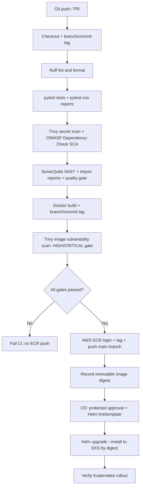

# Python DevSecOps CI/CD: Trivy + SonarQube + ECR + EKS

Interview-focused starter project: **GitHub Actions and Jenkins CI**, then **GitHub Actions CD** using Helm to Amazon EKS. **No DAST / OWASP ZAP. No ECR image scan gate.** Both Trivy secret scanning and **Trivy container vulnerability scanning** run in CI.

## Architecture / stage order



**Security rule:** Trivy scans the locally built Docker image *before* push. A failing scan prevents the image from reaching ECR. Secret scanning is a separate Trivy file-system stage. The policy in both CI examples blocks `HIGH`/`CRITICAL` image vulnerabilities.

## pytest, coverage and SonarQube: who does what?

- **pytest** runs tests and exits nonzero on failures; **pytest-cov/coverage.py** calculates coverage.
- pytest generates `reports/junit.xml`, while pytest-cov generates `reports/coverage.xml`.
- **SonarQube does not run pytest or generate the coverage reports.** It imports them and displays coverage and (where supported by the SonarQube edition/version) test execution metrics. It also performs static analysis and evaluates the configured Quality Gate.
- The workflow gates coverage twice if desired: `--cov-fail-under=80` is an immediate CI gate; configure SonarQube's Quality Gate for coverage on new code (e.g., 80%) and other quality metrics. SonarQube's overall coverage can differ from pytest due to differing calculations and scope.

```bash
mkdir -p reports
pytest --junitxml=reports/junit.xml \
  --cov=app --cov-report=xml:reports/coverage.xml --cov-fail-under=80
sonar-scanner -Dsonar.qualitygate.wait=true
```

`sonar-project.properties` includes:

```properties
sonar.projectKey=python-devsecops-demo
sonar.sources=app
sonar.tests=tests
sonar.python.coverage.reportPaths=reports/coverage.xml
sonar.python.xunit.reportPath=reports/junit.xml
```

**Order matters:** pytest and its reports must complete before invoking `sonar-scanner` in the same workspace.

## Trivy image scan (after Docker build, before push)

```bash
docker build -t "python-demo:${IMAGE_TAG}" .
mkdir -p reports
trivy image --scanners vuln --severity HIGH,CRITICAL --exit-code 1 \
  --format json --output reports/trivy-image.json "python-demo:${IMAGE_TAG}"
```

The JSON file is saved for archiving even if Trivy returns exit code 1 on vulnerabilities; the CI step fails and normal subsequent steps (including ECR push) do not run. Trivy's local vulnerability database must be accessible/cached. A production setup should pin Trivy releases/action SHAs and keep its database updated.

## CI stages

| Stage | Tool | What fails the pipeline? |
|---|---|---|
| Checkout & tag | Git | checkout failure |
| Lint/format | Ruff | code-format or lint violation |
| Unit tests & code coverage | pytest/pytest-cov | failed test or coverage <80% |
| Secret scan | Trivy `fs --scanners secret` | exposed secret |
| SCA | OWASP Dependency-Check | configured CVSS >=7 finding / tool error |
| Static code analysis | SonarQube | failing Quality Gate / analysis error |
| Container build | Docker | build failure |
| **Container vulnerability scan** | **Trivy `image --scanners vuln`** | **HIGH/CRITICAL vulnerability** |
| Login / push | AWS CLI + ECR | login/push error; only `main` pushes in the examples |
| Findings management | archived reports | authenticated DefectDojo / Security Hub integrations are *not* implemented |

**Pipeline behavior:** tests/scans in the current examples run sequentially; an early failure skips later stages. `post { always { ... } }` in Jenkins and `if: always()` in GitHub Actions archive reports created up to that point. For complete security reporting on failures, use independent scan jobs or `catchError`/`continue-on-error` with a final aggregate fail-closed gate.

**Branch tagging:** `feature/ABC-123` becomes a safe Docker tag such as `feature-abc-123-<12charcommit>`. Jenkins uses branch metadata; GitHub Actions uses `GITHUB_REF_NAME`. The sample publishes to ECR only for pushes to `main`; feature branches undergo the image scan but are not published.

## CD with Helm

CD accepts the **approved image digest** as input, and deploys using the Helm chart's image repository and digest. Use `helm/values.yaml`, not manual edits to an `application.yaml` on each build.

```bash
helm lint helm
helm template python-demo helm \
  --set-string image.repository="$ECR_REPOSITORY_URL" \
  --set-string image.digest="$IMAGE_DIGEST"
helm upgrade --install python-demo helm --namespace python-demo \
  --create-namespace --set-string image.repository="$ECR_REPOSITORY_URL" \
  --set-string image.digest="$IMAGE_DIGEST" --atomic --wait --timeout 5m
kubectl rollout status deployment/python-demo -n python-demo --timeout=180s
```

**Production security caveat:** The GitHub CD starter uses manually supplied image digests for teaching. A strict policy should download a verified CI artifact or verify an attestation for the *specific digest*, bind promotion to trusted branches and protected environments, and require approval. Do not assume a manually supplied ECR digest passed Trivy. Add smoke tests and monitoring-based rollback for production.

## Pre-requisites

- GitHub secrets: `AWS_CI_ROLE_ARN`, `AWS_CD_ROLE_ARN`, `AWS_ACCOUNT_ID`, `SONAR_HOST_URL`, `SONAR_TOKEN`; GitHub variable `EKS_CLUSTER`; OIDC trust for AWS role assumption. Set a protected `production` environment.
- Jenkins `docker-aws-tools` agent with Docker, Python, Ruff/pytest from requirements, Trivy, OWASP Dependency-Check, AWS CLI, Sonar Scanner; configured `sonarqube` server and Jenkins `aws-account-id` credential. Jenkins `waitForQualityGate` requires SonarQube webhook integration.
- ECR `python-demo` repo and EKS cluster in `ap-south-1`; appropriate AWS IAM permissions. **ECR built-in image scan is optional and not used as a CI gate.**
- Install/pin Sonar Scanner on GitHub runner; provision Dependency-Check's vulnerability data/API credentials. Pin CI actions and tools to trusted versions for production.
- `Dependency-Check` supports specific ecosystems. Verify your Python dependency file format is actually assessed; consider an additional Python-aware SCA tool such as pip-audit if coverage is incomplete.

## Troubleshooting / failure scenarios

1. **pytest fails:** report recorded; no image build and no push.
2. **Coverage below 80%:** pytest-cov fails; Sonar analysis does not run in the simple sequential workflow; report remains archived.
3. **Sonar Quality Gate fails:** no Docker image build or push.
4. **Trivy flags HIGH/CRITICAL:** the image is built locally but *not pushed to ECR*; JSON report archived.
5. **Trivy cannot update vulnerability DB:** scanning errors and blocks promotion; check outbound access and cache.
6. **ECR push fails:** no digest artifact; deployment not triggered.
7. **Helm rollout times out:** `--atomic` attempts a rollback; inspect `kubectl describe`, events, probes and image pull failures.

## Interview questions

1. Why is Trivy image scanning placed **after Docker build but before ECR push**?
2. Can SonarQube run pytest? What are the roles of `junit.xml` and `coverage.xml`?
3. How do you enforce 80% test coverage in both pytest and SonarQube?
4. How do you ensure failing vulnerability scans block publishing yet preserve reports?
5. What differs between Trivy secret scan and Trivy image scan?
6. What are the trade-offs of SonarQube SAST vs OWASP Dependency-Check SCA?
7. Why use a branch/Jira tag for traceability but deploy by immutable digest?
8. How do Jenkins and GitHub Actions authenticate to AWS without long-lived access keys?
9. How do you guarantee CD deploys a digest that passed CI, not just any ECR digest?
10. What steps help diagnose and roll back an unhealthy Helm release?

## Official docs

- SonarQube Python coverage: https://docs.sonarsource.com/sonarqube-server/2025.1/analyzing-source-code/test-coverage/python-test-coverage
- SonarQube test execution import: https://docs.sonarsource.com/sonarqube-server/2025.6/analyzing-source-code/test-coverage/test-execution-parameters
- Trivy image scanning: https://trivy.dev/docs/latest/guide/target/container_image/
